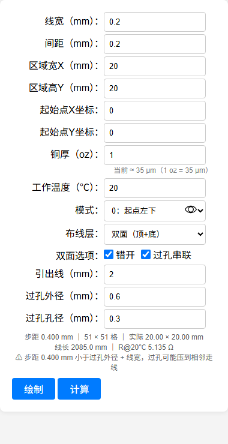

# eext-hilbert-creator

嘉立创EDA & EasyEDA 专业版扩展 —— 希尔伯特曲线生成器

> [!NOTE]
> 本项目 fork 自 [klxf/eext-hilbert-creator](https://github.com/klxf/eext-hilbert-creator)，
> 在原作者版本的基础上，使用 AI 辅助开发（DeepSeek Harness）做了较大改动，
> 作者信息与开源协议均沿用原项目。

## 相对原项目新增的功能

| 功能 | 说明 |
|---|---|
| 参数化布局 | 直接输入线宽、间距、区域宽高；步距 = 线宽 + 间距，横纵一致，格子恒为正方形 |
| 矩形曲线修正 | 长宽比达到 2:1 时沿长边二分，并自动挑选最优终点角点，矩形区域也是方方正正的希尔伯特结构，不再出现梳状长条 |
| 双面错开 | 底层整体偏移半个步距，正好落在顶层走线的空隙里，正反面交替发热、温度更均匀 |
| 过孔串联 | 远端打一个过孔把正反面接成一条回路，近端两层的末端各引出一段线当接线端子 |
| 电阻模型 | 按铜厚（oz）与温度计算：R = ρ(T)·L/(w·t)，ρ₂₀ = 0.01724 Ω·mm²/m，α = 0.00393 /℃；并统一了阻值计算器的电阻率 |
| 实时信息 | 输入时实时显示步距、网格、区域实际尺寸、铜箔线长与电阻 |
| 绘制加速 | 合并同向连续线段（图元减少约 40%）+ 分批并发提交，不再逐段 await |
| 模式语义 | 模式 0/1/2/3 直接标注为起点所在角（左下 / 右下 / 左上 / 右上），示例图重画 |



## 开始使用

1. 直接下载 [release/eext-hilbert-creator_v1.6.6.eext](release/eext-hilbert-creator_v1.6.6.eext)，在 **嘉立创EDA** 或 **EasyEDA** 专业版中安装；也可以拉源码后 `npm run build`，产物在 `build/dist`

2. 在 PCB 页面中，点击顶部菜单的 `希尔伯特` → `生成希尔伯特曲线...`，即可打开本扩展

3. 输入线宽、间距、起始点、区域宽高，即可自动生成曲线，并实时显示步距、网格、线长与电阻

    - **步距** = 线宽 + 间距；区域宽高决定列数与行数，矩形靠行列铺满，不会把曲线拉长
    - **双面错开**：底层整体偏移半个步距，落在顶层走线的空隙里
    - **过孔串联**：远端一个过孔把正反面接成一条回路，近端两层各引出一段接线端子
    - **电阻**：按铜厚（oz，直接填数字，默认 1 oz = 35 μm）与工作温度计算
    - **模式**：0/1/2/3 分别对应起点在矩形左下、右下、左上、右上，0↔1、2↔3 互为镜像
    - **布线层**：可选顶层、底层或双面（顶+底）

    

4. 使用“铜线阻值计算器”可便捷计算线长或线宽

## 开发

```bash
npm install
npm run build   # 编译 dist/index.js 并打包 build/dist/*.eext
```

主要文件：

- `iframe/js/hilbert.js`：矩形网格上的希尔伯特曲线几何（纯计算，不依赖 EDA API）
- `iframe/js/main.js`：步距/网格计算、双面错开与过孔、分批绘制、电阻计算
- `iframe/index.html`：参数面板与交互

想把这些改动回馈给原项目时，[docs/pull-request.md](docs/pull-request.md) 里有完整的 PR 流程与可直接使用的描述文案。

## 来源与许可

- 原项目：[klxf/eext-hilbert-creator](https://github.com/klxf/eext-hilbert-creator)（作者 Mr_Fang）
- 改进部分使用 AI 辅助开发完成
- 协议：原项目采用 [The Unlicense](https://choosealicense.com/licenses/unlicense/)，本项目**沿用同一协议**，同样释放到公有领域